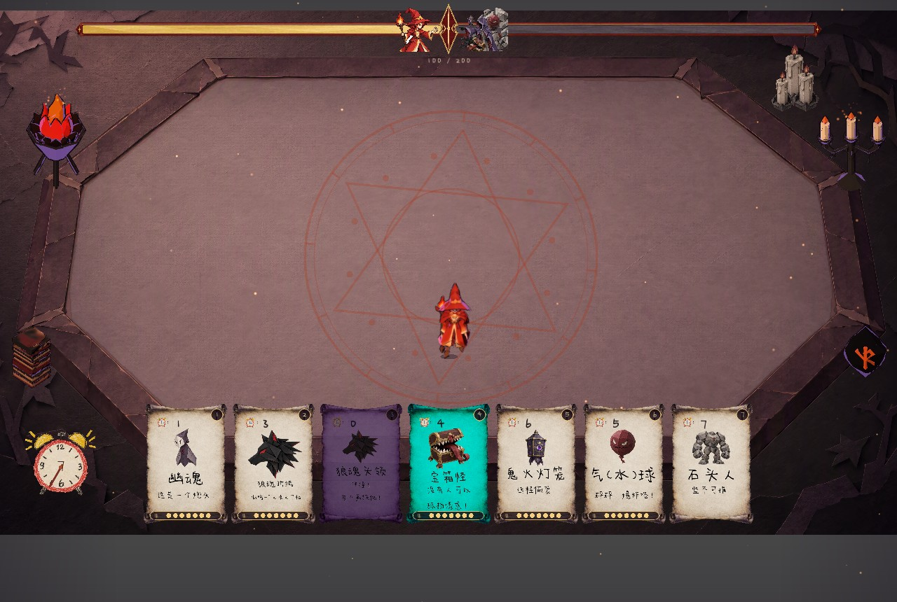
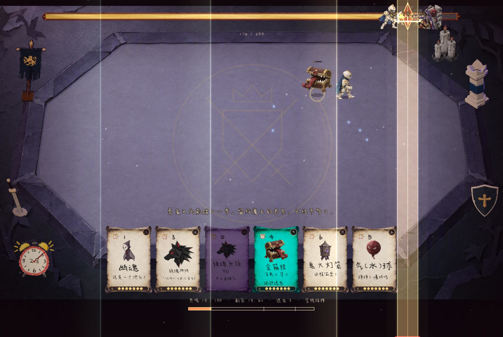

# 魔王禁书 · 公开试玩

**反向塔防 × 节奏 × 哥特折纸立体书**

你是被封在禁书里的魔王。从书页边缘召唤魔物，让闯入者的士气归零。

**[下载试玩 Demo](https://github.com/ghostkingdom666/mowang-jinshu-demo/releases/tag/v0.1.0-demo.1)** · **[报告 Bug](https://github.com/ghostkingdom666/mowang-jinshu-demo/issues/new?template=bug_report.yml)** · **[提交试玩反馈](https://github.com/ghostkingdom666/mowang-jinshu-demo/issues/new?template=playtest_feedback.yml)**

本仓库用于试玩包发布、版本说明和玩家反馈，不存放游戏工程或源素材。项目为 TECHATHON 2026 参赛作品。

## 下载与启动

在上方下载页的 **Assets** 中选择系统对应的文件，解压后运行，无需安装 Godot。

| 平台 | 文件 | 启动方式 |
|---|---|---|
| Windows x64 | `mowang-jinshu-demo-0.1.0-demo.1-windows-x64.zip` | 解压后运行 `mowang-jinshu-demo.exe` |
| macOS Intel / Apple Silicon | `mowang-jinshu-demo-0.1.0-demo.1-macos-universal.zip` | 解压后打开 `.app` |

下载页另附 `SHA256SUMS.txt`，可核对下载文件。macOS 包为未公证的试玩构建，尚未在 macOS 真机验证；遇到系统拦截或启动异常，请在 Bug 反馈中附上具体提示。

## 可以试玩什么

- **三个普通章节**：旋转剑骑士、六发左轮游侠、火焰法师。
- **肉鸽试炼**：三位勇者随机连战，升级时选择兵种与秘术。
- **召唤与集结**：外围部署，短时间连点集结，用失败风险换取爆发。
- **魔王指挥**：跟随音乐敲击节拍，积累共鸣、获取战斗奖励。
- **立体书图鉴**：查看十一种魔物，包括四种新头领及其能力。

试玩版包含尚在调整的机制、数值和临时卡面，欢迎反馈难度、节奏与可读性问题。

## 三分钟上手

1. 从主菜单进入第一章；首次游玩可跟随引导。
2. 点击下方卡牌，再点击高亮的外围区域召唤。
3. 魔物命中勇者会降低其士气；魔物阵亡则增加勇者士气。推到 **0** 获胜，升到 **200** 失败。
4. 把握勇者的防御空档，组合炮灰、突击、诱敌、远程和控场单位。

| 操作 | 按键 |
|---|---|
| 选卡 | 点击卡牌，或 `1–9`、`0`、`-` |
| 召唤 / 集结 | 点击高亮的合法部署区域 |
| 结束本轮召唤 | 右键或 `Esc` |
| 魔王指挥 | `Space` |
| 肉鸽升级选择 | 点击，或 `1 / 2 / 3` |
| 暂停 | `P` 或 `Esc`（先结束召唤） |
| 跳过开场 / 演出 | `Space` 或左键 |

更多说明见 [玩家入门](docs/PLAYER_GUIDE.md)。

## 帮我们把游戏做得更好

- **卡住、闪退、操作异常、画面或音频错误**：使用 [Bug 表单](https://github.com/ghostkingdom666/mowang-jinshu-demo/issues/new?template=bug_report.yml)。
- **难度、平衡、节奏、玩法建议、整体体验**：使用 [试玩反馈表单](https://github.com/ghostkingdom666/mowang-jinshu-demo/issues/new?template=playtest_feedback.yml)。
- 提交前可先看 [已有反馈](https://github.com/ghostkingdom666/mowang-jinshu-demo/issues)，相同问题可补充复现信息或点赞。

提交反馈需要 GitHub 账号。请写明试玩版本、系统和所处关卡；截图或短视频会很有帮助。详细流程见 [反馈指南](SUPPORT.md)。

## 版本与资源说明

- [全部试玩版本](https://github.com/ghostkingdom666/mowang-jinshu-demo/releases)
- [更新记录](CHANGELOG.md)
- [第三方资源与致谢](THIRD_PARTY_NOTICES.md)

游戏、美术、音乐及第三方素材的权利归相应权利人所有。本仓库发布试玩成品，不提供游戏工程或素材的开源许可。
